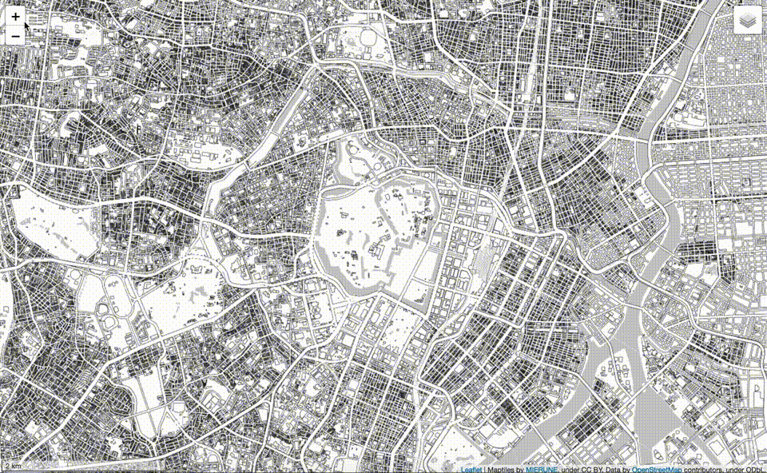

# leaflet-starter


Start Leaflet easily.  
- [Leaflet v1.9.4](https://leafletjs.com)  
- [TypeScript v7.0.2](https://www.typescriptlang.org)  
- [Vite v8.3.2](https://vitejs.dev)  
- node v24.21.0
- pnpm v11.9.0

<br>

## Usage


<br>

Install package

Use Node.js v24.21.0 (`.node-version`) and pnpm v11.9.0 (`packageManager`). Install pnpm with `npm install --global pnpm@11.9.0` if needed.
```bash
pnpm install --frozen-lockfile
```

<br>

build
```bash
pnpm run build
```

<br>

dev
```bash
pnpm run dev
```

<br>

test

Install Chromium before the first test run.

```bash
pnpm exec playwright install chromium
```

```bash
pnpm test
```

Tests cover the site root and `/leaflet-starter/` with local tile fixtures. The subpath build is written to `dist-subpath/`.

`pnpm run test:visual` compares both views with local baselines. Check the map by eye, then create the baselines explicitly with `pnpm run test:visual:update`. A missing baseline fails without creating a file.

<br>

GitHub Pages

After CI succeeds for a push to `main`, `.github/workflows/pages.yml` builds that tested commit and deploys `dist/`. Pull requests and failed CI runs do not trigger an automatic deployment. Set the repository's Pages source to **GitHub Actions** and restrict the `github-pages` environment to `main`; see [the setup steps](.github/AUTOMATION.md#github-pages).

The workflow sets `VITE_BASE` to `/<repository-name>/` and uses the existing Vite configuration. To preview the Pages build locally:

```bash
VITE_BASE=/leaflet-starter/ pnpm run build
pnpm run preview --base /leaflet-starter/
```

Generated build outputs are ignored and are not committed.

<br>

Maintenance

For tools outside the daily dependency updates (Playwright, Node.js types, Prettier, Node.js and pnpm), follow [the manual update procedure](.github/AUTOMATION.md#manual-tooling-updates).

<br>

format

`pnpm run format:check` checks formatting without rewriting files.

```bash
pnpm run format
```

<br>
<br>



<br>

## License
MIT

Copyright (c) 2018-2026 Yasunori Kirimoto

<br>

---

<br>

### Japanese

<br>

# Leaflet スターター


Leafletを手軽に始める
- [Leaflet v1.9.4](https://leafletjs.com)  
- [TypeScript v7.0.2](https://www.typescriptlang.org)  
- [Vite v8.3.2](https://vitejs.dev)  
- node v24.21.0
- pnpm v11.9.0

<br>

## 使用方法


<br>

パッケージインストール

Node.js v24.21.0（`.node-version`）とpnpm v11.9.0（`packageManager`）を使用します。pnpm未導入の場合は`npm install --global pnpm@11.9.0`で導入します。

```bash
pnpm install --frozen-lockfile
```

<br>

ビルド

```bash
pnpm run build
```

<br>

開発

```bash
pnpm run dev
```

<br>

テスト

初回はテスト用のChromiumをインストールしてください。

```bash
pnpm exec playwright install chromium
```

```bash
pnpm test
```

ローカルのタイルfixtureを使い、サイトのルートと`/leaflet-starter/`配下を検査します。サブパス用のビルド先は`dist-subpath/`です。

`pnpm run test:visual`は両方の表示をローカルのベースラインと比較します。地図を目で確認したあと、`pnpm run test:visual:update`で明示的にベースラインを作成します。ベースラインがない場合はファイルを作成せず失敗します。

<br>

GitHub Pages

`main`へのpushに対するCIが成功すると、`.github/workflows/pages.yml`がCIで検証したコミットをビルドし、`dist/`を自動公開します。PRやCI失敗時には自動公開しません。リポジトリのPages公開元を**GitHub Actions**に変更し、`github-pages`環境の公開対象を`main`に限定してください。[設定手順](.github/AUTOMATION.md#github-pages)を参照してください。

ワークフローは`VITE_BASE`に`/<リポジトリ名>/`を指定し、既存のVite設定でビルドします。Pages用ビルドをローカルで確認する場合:

```bash
VITE_BASE=/leaflet-starter/ pnpm run build
pnpm run preview --base /leaflet-starter/
```

生成されたビルド成果物はGitの管理対象外で、コミットしません。

<br>

保守

日次の依存関係更新に含まれないPlaywright、Node.jsの型定義、Prettier、Node.js、pnpmは、[手動更新手順](.github/AUTOMATION.md#manual-tooling-updates)に沿って確認・更新します。

<br>

整形

`pnpm run format:check`は、ファイルを書き換えずに整形を確認します。

```bash
pnpm run format
```

<br>
<br>


<br>

## ライセンス
MIT

Copyright (c) 2018-2026 Yasunori Kirimoto

<br>
